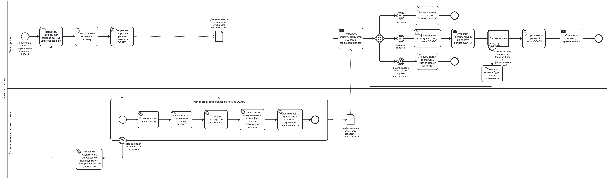
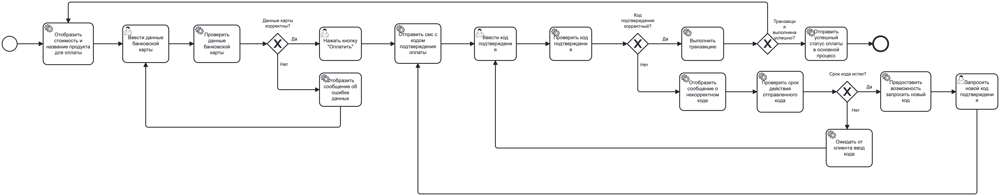

# Моделирование бизнес-процесса электронного оформления полиса ОСАГО в нотации BPMN 2.0

Моделирование сквозного процесса оформления страхового полиса ОСАГО — от поступления заявки до выдачи полиса — с использованием обычного подпроцесса и глобального подпроцесса (Call Activity) для онлайн-оплаты.

**Инструменты и стек:** BPMN 2.0, Camunda Modeler / bpmn.io, бизнес-анализ, моделирование процессов

---

## Постановка задачи

Создать BPMN-диаграмму процесса электронного оформления полиса ОСАГО, используя **обычный подпроцесс** и **глобальный подпроцесс «Вызов»**.

**Участники процесса:**
* **Отдел продаж** — принимает заявку, консультирует клиента, формирует и отправляет полис.
* **Система расчета страхового полиса** — анализирует данные клиента и рассчитывает страховую премию.
* **Система оплаты** и **Клиент** — участники глобального подпроцесса оплаты.

**Этапы процесса:**
1. **Прием заявки** — менеджер получает заявку, звонит клиенту, вносит данные в систему и отправляет их на расчет.
2. **Расчет стоимости (подпроцесс)** — верификация документов, проверка страховой истории и штрафов по автомобилю, определение страховой суммы и тарифа, формирование финальной стоимости. Если верификация не пройдена — менеджер получает уведомление о необходимости повторно связаться с клиентом.
3. **Предложение клиенту** — менеджер отправляет стоимость и условия (предложение действует 5 дней):
   * отказ клиента → заявка закрывается со статусом «Отказ клиента»;
   * нет ответа более 5 дней → заявка закрывается со статусом «Нет ответа от клиента»;
   * согласие → формируется и отправляется ссылка на оплату (действует 1 час).
4. **Онлайн-оплата (глобальный подпроцесс)** — отображение стоимости, ввод и проверка данных карты, SMS-код подтверждения с контролем срока действия и повторной отправкой, выполнение транзакции и обработка ошибок.
5. **Выдача полиса** — менеджер формирует полис ОСАГО и отправляет его клиенту.

---

## Основной процесс

## Глобальный подпроцесс «Онлайн-оплата»

*Векторные версии диаграмм: [основной процесс (SVG)](./images/main_process.svg), [подпроцесс оплаты (SVG)](./images/payment_subprocess.svg).*

---

## Использованные элементы BPMN

| Элемент | Где применён |
|---|---|
| Пул и дорожки (Pool / Lanes) | Страховая компания: «Отдел продаж», «Система расчета страхового полиса» |
| Ручные, пользовательские, сервисные задачи и задачи отправки | Звонок клиенту, ввод данных, автоматические проверки, отправка предложения и полиса |
| Обычный подпроцесс (Sub-Process) | Расчет стоимости полиса ОСАГО |
| Глобальный подпроцесс (Call Activity) | Онлайн-оплата |
| Граничные события ошибки (Boundary Error) | Верификация документов не пройдена; срок ссылки на оплату истек |
| Шлюз на основе событий (Event-Based Gateway) | Ожидание реакции клиента на предложение |
| Условные промежуточные события | Согласие клиента / отказ клиента |
| Промежуточное событие таймера | Прошло более 5 дней с даты отправки предложения |
| Эксклюзивные шлюзы (XOR) | Проверки данных карты, кода подтверждения, срока кода и результата транзакции |
| Объекты данных (Data Objects) | Данные клиента для расчета; информация о стоимости полиса |

---

## Структура проекта

* `bpmn/main_process.bpmn` — основной процесс (открывается в [Camunda Modeler](https://camunda.com/download/modeler/) или на [demo.bpmn.io](https://demo.bpmn.io/)).
* `bpmn/payment_subprocess.bpmn` — глобальный подпроцесс онлайн-оплаты.
* `images/` — диаграммы в форматах PNG и SVG.
* `README.md` — описание проекта.

---

[⬅ Вернуться на главную страницу портфолио](https://github.com/mirilina/mirilina)
